# Roadmap: Linux 7.3 on Proxmox VE 9

  

**Status: in development.** Nothing here has shipped. This is a separate direction from
[ROADMAP.md](ROADMAP.md) and may change as we test.

## Why

On 2026-11-18 Proxmox published an opt-in Linux 7.3 kernel for Proxmox VE 9
([forum announcement](https://forum.proxmox.com/threads/opt-in-linux-7-3-kernel-for-proxmox-ve-9-available.187665/)).
What the announcement says:

- Package `proxmox-kernel-7.3` (seen running as `7.3.5-1-pve`), from the `pve-test` or
  `pve-no-subscription` repository: `apt update`, `apt install proxmox-kernel-7.3`, reboot.
- 7.0 stays the default and the kernel Proxmox recommends for production.
- 7.3 is built from the kernel.org stable branch, not Ubuntu's kernel as earlier Proxmox kernels
  were, so an Ubuntu patch or build option may be missing. Proxmox expects 7.3 to become this
  year's upstream long-term kernel.

The announcement mentions no change to the Proxmox VE API, so the server keeps working on either
kernel. This roadmap is about seeing the change, testing on it, and running the 7.3 kernel ourselves.

## Dogfooding: a nested Proxmox VE node

We'll test 7.3 on a throwaway Proxmox VE node that runs as a VM, built by this server's own tools.
That gives us:

- a first live run of the v2.14.0 deploy tools, which have only had unit tests so far;
- a 7.3 node to test every toolset against, without touching a production node;
- a second Proxmox VE cluster for Datacenter Manager, which [ROADMAP.md](ROADMAP.md) needs to
  test cross-cluster migration live.

The full list of what still needs a live run is in [ROADMAP.md](ROADMAP.md#live-testing).

## Planned

### 1. Kernel and package versions on a node

**Status:** shipped in v2.17.0: `get_node_kernel`, `get_node_apt_versions`, `get_node_apt_history` and `get_node_apt_repositories`, plus `refresh_node_apt_index` and repository changes. The limits below still hold.

**Today:** `get_node_status` reports the running kernel. `get_node_apt_update` lists pending
updates and `get_node_apt_changelog` reads a package changelog.

**Add:** a read-only tool for `GET /nodes/{node}/apt/versions`, which lists the installed versions
of Proxmox's main packages, kernels included. It answers "is 7.3 installed on this node, and is it
the one running?" A repository read (`GET /nodes/{node}/apt/repositories`) would show whether
`pve-no-subscription` or `pve-test` is set up. Both are reads, in the `nodes` toolset.

**Limit:** the Proxmox VE API can refresh the package index, but it can't install a chosen package
or pick the boot kernel. Installing 7.3 and pinning a kernel (`proxmox-boot-tool kernel pin`)
stay root-shell steps, and the tools will say so.

### 2. Live-run the existing deploy tools

`deploy_pve_vm` reuses the builder behind `deploy_pdm_vm`, so `deploy_pdm_vm` gets its first
live run first, then `deploy_ubuntu_vm`, each with throwaway guests. We fix what that turns up
before building on it.

### 3. `deploy_pve_vm`: a nested Proxmox VE node

Ask for a Proxmox VE node and get a running one, using Proxmox's documented route of installing
Proxmox VE on Debian:

1. Debian 13 `genericcloud` image from `cloud.debian.org`, checked against `SHA512SUMS`
   (the same image `deploy_pdm_vm` uses).
2. cloud-init on the seed ISO: set the hostname and make it resolve to the guest's address in
   `/etc/hosts`, add the `pve-no-subscription` repository, install `proxmox-ve`, remove
   `os-prober`, and optionally install `proxmox-kernel-7.3` (a `kernel` input: `default` or
   `7.3`), then reboot.
3. The VM gets `cpu: host` so it can run its own guests. The physical node needs nested
   virtualization turned on (`kvm_intel nested=1` or `kvm_amd nested=1`); the tool checks and
   says so if it's off.
4. **Done means reachable:** the guest agent reports an address, `https://<ip>:8006` answers,
   and the running kernel matches what was asked for. The result returns the URL and the
   `root@pam` credential once, like the other deploy tools.

Same safety as the other deploy tools: writes, not destructive; refuses a name or VMID in use;
respects `PROXMOX_PROTECTED_VMIDS` and read-only mode. Suggested size: 4 vCPU, 8 GB RAM, 64 GB disk.

### 4. Test against 7.0 and 7.3

Run the toolsets against the nested node on 7.3 and against a 7.0 node, and note any differences
in the tool docs. After that the nested node becomes a Datacenter Manager remote, as the second
cluster for cross-cluster migration tests.

## Could change

Early reports in the announcement thread (first page, through 2026-11-20). None of them are
confirmed problems for this server, but we'll watch them:

- **ZFS disk utilization.** One user sees much higher disk %util on 7.3. It isn't known whether
  that's real load or a change in how it's counted. If it's counted differently, RRD and
  disk-stats outputs read differently on 7.3 than on 7.0, and the tool docs should say so.
- **Kernel built from kernel.org.** An Ubuntu patch or build option may be missing. That could show
  up as a hardware or driver difference on the nested node.
- **Missing NIC firmware.** A Realtek r8157 USB NIC logs a missing firmware file (the NIC still
  works). It doesn't affect a VM with VirtIO networking.
- **New boot-log messages.** A `W^X violation` warning and a TDX "not supported" notice appear
  at boot. Anything that reads the syslog or journal will see them.

## Stays the same

- The Proxmox VE API. No change is announced, so every existing tool works on either kernel.
- 7.0 stays the default. Nothing here asks anyone to move a production node to 7.3.
